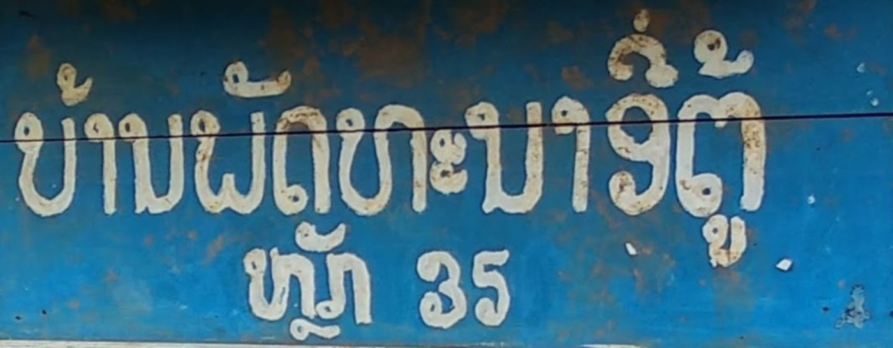

# Blue Market Brush ຫຼັກ 35

**A free display font for Lao, Thai, Khmer and English, drawn from a hand-painted sign photographed in Laos.**
Licensed under the [SIL Open Font License 1.1](OFL.txt). **Status: beta (0.100).** Some letters are still drafts.

[Try it online](https://rcampbellbassac.github.io/BlueMarketBrush/) ·
[Download](https://github.com/rcampbellbassac/BlueMarketBrush/releases/latest/download/BlueMarketBrush.zip) ·
[All our fonts](https://rcampbellbassac.github.io/fonts/)

## The sign

Broad, friendly market-sign brush: soft bowls, bulbous loop heads, slightly uneven widths. Ink re-joined across the overhead wire (segment.py --vclose 15 --close 9).
Sign text: ບ້ານພັດທະນາ … ຫຼັກ 35

Lao letters traced from the sign: **ບ າ ນ ພ ັ ດ ອ 3 5**.
Every other letter, and all of Thai, Khmer and Latin, is generated to match their stroke and proportions, and is a
draft to be redrawn before 1.0.

## Install

1. Download `BlueMarketBrush.zip` from the [latest release](https://github.com/rcampbellbassac/BlueMarketBrush/releases/latest).
2. Unzip it, open `BlueMarketBrush-Regular.ttf` and click **Install**.
3. On a website, use `BlueMarketBrush-Regular.woff2`.

## Quality checks

- Shaping corpus (21 Lao/Thai/Khmer/Latin cases): 0 missing glyphs
- Required characters: 653/653; recommended: 607/625
- Full report: [qa/report.json](qa/report.json)

## Files

| Path | What |
|---|---|
| `fonts/` | TTF and WOFF2 |
| `sources/` | sign ink extraction, letter labels, traced outlines, build spec |
| `scripts/` | segmentation, tracing, fitting and merge tools |
| `docs/` | the website (GitHub Pages) |

## Credits

Designed by Robert Martin Campbell from his photograph. Generated letters derive from the
[Noto fonts](https://github.com/notofonts) (SIL OFL 1.1). See [FONTLOG.txt](FONTLOG.txt).
